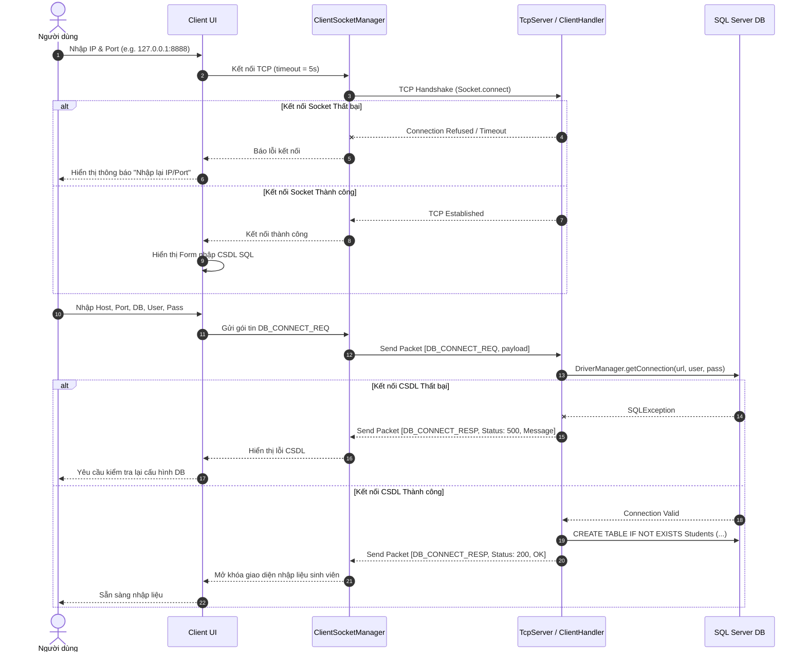
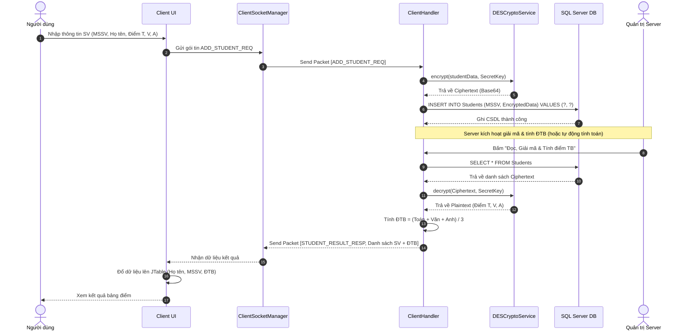
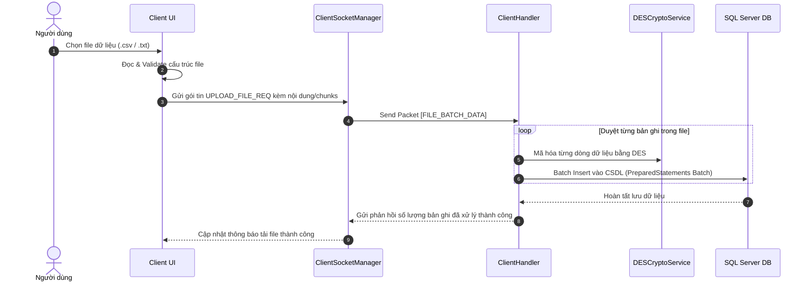

# THIẾT KẾ KIẾN TRÚC HỆ THỐNG (SYSTEM ARCHITECTURE & DESIGN)

---

### 1. Kiến trúc Tổng thể (High-Level Architecture)

Hệ thống hoạt động theo mô hình **Client - Server tập trung** qua giao thức mạng **TCP/IP Socket**:

```
+-------------------------------------------------------------+
|                      CLIENT SUBSYSTEM                       |
|  +--------------------+    +-----------------------------+  |
|  |   Swing UI Layer   |    |    Network Client Layer     |  |
|  | (CardLayout / JTab)|<-->| (Socket, Stream IO, Worker) |  |
|  +--------------------+    +-----------------------------+  |
+------------------------------------------^------------------+
                                           |
                                [TCP Stream / Port 8888]
                                [Custom Framing Protocol]
                                           |
+------------------------------------------v------------------+
|                      SERVER SUBSYSTEM                       |
|  +-------------------------------------------------------+  |
|  |         TCP Server Listener (ServerSocket)            |  |
|  +-------------------------------------------------------+  |
|  |   Thread Pool Manager (ExecutorService, Multi-thread) |  |
|  +-------------------------------------------------------+  |
|  |               ClientHandler Session Layer             |  |
|  +-------------------------------------------------------+  |
|  |         Business Logic & DES Cryptography Layer       |  |
|  +-------------------------------------------------------+  |
|  |              Data Access Layer (DAO, JDBC)            |  |
|  +-------------------------------------------------------+  |
|                             |                               |
|                     [JDBC Driver]                           |
|                             v                               |
|              +-----------------------------+                |
|              |      SQL Server Database    |                |
|              |     (Encrypted Student DB)  |                |
|              +-----------------------------+                |
+-------------------------------------------------------------+
```

---

### 2. Mô hình Đa luồng và Xử lý Bất đồng bộ (Concurrency Design)

#### 2.1. Phân hệ Server: Mô hình Thread Pool (ExecutorService)
- Không dùng `new Thread(clientHandler).start()` cổ điển vì dễ bị tấn công cạn kiệt tài nguyên (Resource Exhaustion) khi có nhiều kết nối mở liên tục.
- Sử dụng `ThreadPoolExecutor` thông qua `Executors.newFixedThreadPool(MAX_THREADS)` (hoặc `CachedThreadPool` có giới hạn):
  - **Main Thread**: Chạy vòng lặp vô tận `while (isRunning) { Socket client = serverSocket.accept(); executor.submit(new ClientHandler(client)); }`.
  - **Worker Threads**: Nhận phiên làm việc (Session) của từng Client, liên tục lắng nghe và phân tích các gói tin từ `DataInputStream` của Socket tương ứng.

#### 2.2. Phân hệ Client: Đảm bảo UI mượt mà bằng SwingWorker
- **Nguyên tắc vàng của Swing**: Không thực hiện các tác vụ blocking I/O (như `socket.connect()`, gửi dữ liệu, đọc stream) trên **EDT (Event Dispatch Thread)**. Nếu vi phạm, giao diện sẽ bị đơ cứng (Frozen / Not Responding).
- Mọi thao tác mạng trên Client đều được đóng gói trong một `SwingWorker<T, V>`:
  - Hàm `doInBackground()`: Chạy trên Background Thread thực hiện kết nối Socket, gửi/nhận dữ liệu.
  - Hàm `done()`: Được tự động kích hoạt trở lại trên EDT để cập nhật dữ liệu lên bảng `JTable`, thanh tiến trình `JProgressBar` hoặc hiển thị thông báo `JOptionPane`.

---

### 3. Thiết kế Phân tầng Chi tiết (Layered Architecture)

Cả hai phân hệ Client và Server đều được chia tách thành các tầng độc lập nhằm đảm bảo tính đơn nhiệm (Single Responsibility Principle) và dễ bảo trì:

#### Phân hệ Client:
1. **`ui` (Presentation Layer)**:
   - `ConnectServerFrame`: Màn hình nhập IP, Port kết nối Server.
   - `ConnectDatabaseDialog`: Màn hình cấu hình thông số CSDL gửi lên Server.
   - `MainClientFrame`: Màn hình chính chứa bảng điểm, form nhập sinh viên, nút đính kèm file, thanh trạng thái kết nối.
2. **`network` (Network Service Layer)**:
   - `ClientSocketManager`: Quản lý vòng đời của đối tượng `Socket`, `DataInputStream`, `DataOutputStream`. Đóng mở kết nối an toàn.
   - `NetworkWorker`: Các lớp thừa kế `SwingWorker` phục vụ việc gửi nhận bất đồng bộ.
3. **`model` (Data Transfer Objects - DTO)**:
   - `StudentDTO`, `DBConfigDTO`, `ProtocolPacket`.

#### Phân hệ Server:
1. **`server` (Network Listener Layer)**:
   - `TcpServer`: Khởi tạo `ServerSocket`, quản lý Thread Pool và vòng lặp tiếp nhận Client.
   - `ClientHandler`: Xử lý giao tiếp với một Client cụ thể trên luồng riêng biệt.
2. **`crypto` (Security Layer)**:
   - `DESCryptoService`: Thực hiện mã hóa (Encrypt) và giải mã (Decrypt) theo chuẩn DES bằng `javax.crypto.Cipher`.
3. **`dao` (Data Access Layer)**:
   - `DBConnectionManager`: Quản lý kết nối JDBC động tới SQL Server theo thông số Client cung cấp.
   - `StudentDAO`: Thực hiện các lệnh SQL `INSERT`, `SELECT` với dữ liệu đã mã hóa qua `PreparedStatement`.
4. **`ui` (Server Dashboard & Controller Layer)**:
   - `ServerDashboardFrame`: Giao diện giám sát Server, hiển thị Log kết nối thời gian thực, nút chức năng "Giải mã và Tính điểm trung bình".

---

### 4. Biểu đồ Tuần tự Chi tiết (Sequence Diagrams)

#### 4.1. Luồng 1: Kết nối Socket và Cấu hình CSDL Động


#### 4.2. Luồng 2: Nhập liệu Sinh viên -> Mã hóa DES -> Lưu DB -> Tính ĐTB -> Trả kết quả


#### 4.3. Luồng 3: Đính kèm File mẫu (Batch File Upload)


---

### 5. Các Mẫu Thiết Kế (Design Patterns) Được Ứng Dụng

| Tên Design Pattern | Vị trí áp dụng | Mục đích và Lợi ích mang lại |
| :--- | :--- | :--- |
| **Singleton Pattern** | `DatabaseConnectionManager`, `DESCryptoService` | Đảm bảo chỉ có một instance duy nhất quản lý connection và mật mã, tiết kiệm tài nguyên bộ nhớ và tránh race condition. |
| **DAO Pattern (Data Access Object)** | `StudentDAO`, `IStudentDAO` | Tách biệt hoàn toàn tầng truy vấn cơ sở dữ liệu (SQL) khỏi tầng xử lý logic nghiệp vụ mạng. Dễ dàng đổi loại CSDL (SQL Server sang MySQL) mà không ảnh hưởng Server. |
| **DTO Pattern (Data Transfer Object)** | `StudentDTO`, `DBConfigDTO`, `PacketMessage` | Đóng gói dữ liệu truyền tải giữa Client và Server qua Socket thành các đối tượng có cấu trúc rõ ràng. |
| **Factory / Strategy Pattern** | `PacketHandlerFactory` | Ánh xạ mã lệnh (Command Code) trong gói tin sang bộ xử lý (Handler) tương ứng, loại bỏ các khối `switch-case` khổng lồ, dễ dàng mở rộng chức năng mới. |
| **Observer Pattern** | `ServerLogListener`, `ConnectionStateListener` | Thông báo sự kiện mạng cho giao diện UI cập nhật trạng thái mà không gây phụ thuộc ngược (Decoupling UI & Network). |
